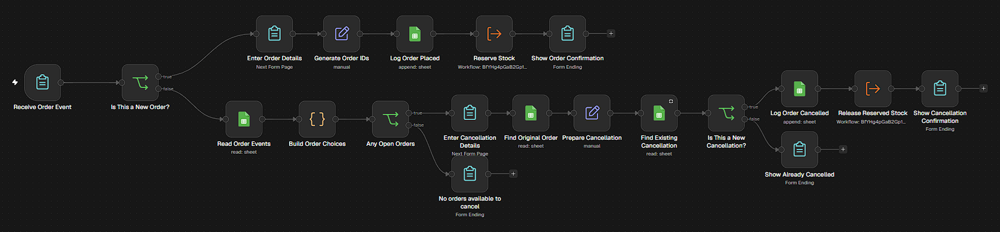
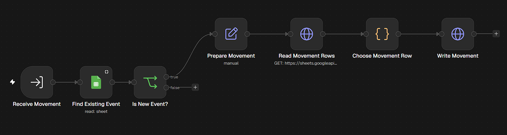
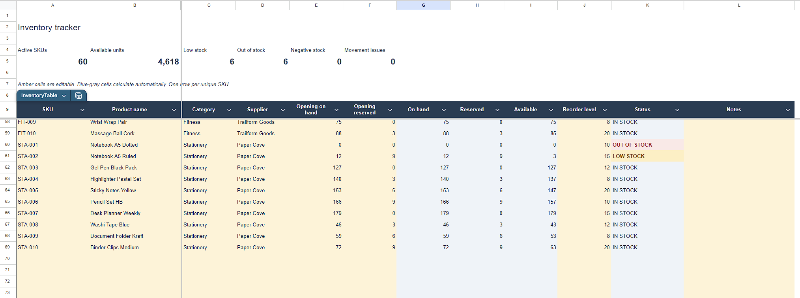
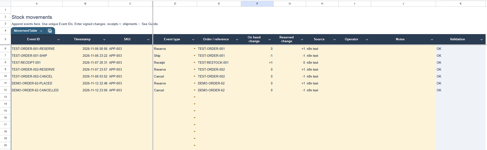

# Ecommerce operations

This project uses n8n and Google Sheets to track inventory. When someone places an order through the form, n8n logs the order and reserves the requested quantity. Cancelling the order releases those units back into available stock. Both stock changes are recorded in the **Movements** tab.

## Run locally

Start Docker Desktop and run these commands from the repo folder.

```powershell
docker compose up -d
docker compose ps
```

Open [n8n](http://localhost:5679). Run `docker compose down` to stop it and keep your saved workflows and credentials.

## Project files

- [Inventory tracker](https://docs.google.com/spreadsheets/d/14tQW_PhDiIsmKy9FvRWwH2zJrzleN0PjWConfEcOP-c/edit)
- [Workflow exports](workflows/) for order intake, inventory movements, and manual testing.
- [Workbook template and generator](inventory-tracker/)

## Workflows

### Order Event Intake



### Process Inventory Movement



## Inventory tracker

### Inventory



### Movements


